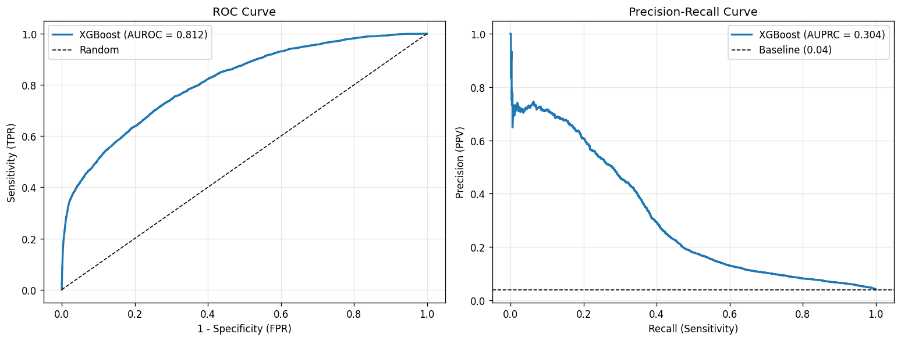
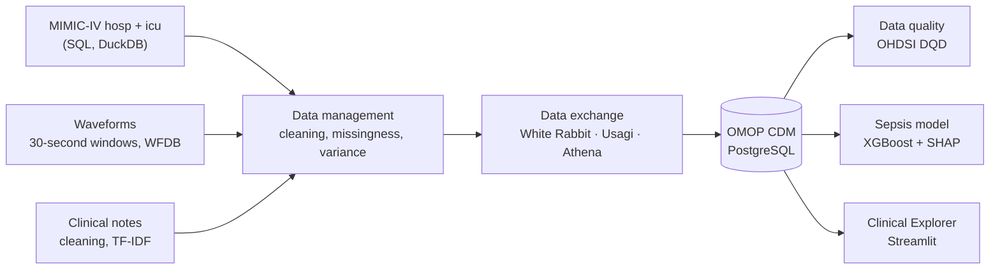
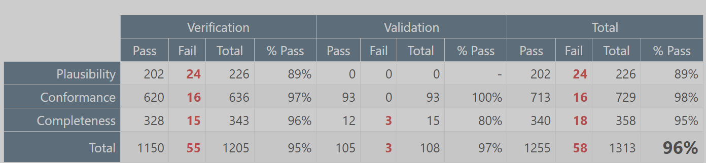
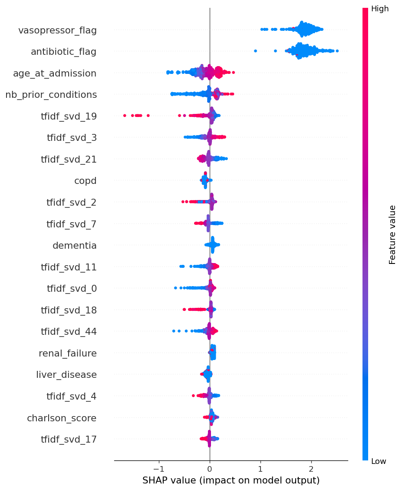
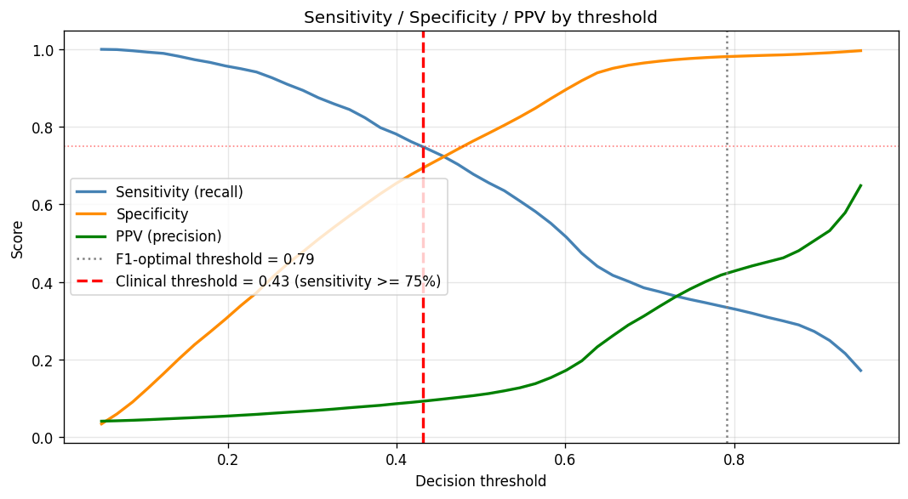

<div align="center">

# Early Sepsis Detection on MIMIC-IV

From raw hospital records, bedside waveforms and clinical notes to a standardized OMOP database,<br>
a sepsis risk model and an interactive clinical explorer.




</div>

<br>

| | |
|---|---|
| Context | Team project, *Health Big Data* laboratory, Politecnico di Milano (spring 2026), supervised by Prof. Maria Gabriella Signorini and Pierluigi Reali |
| Data | MIMIC-IV 3.1 (hosp and icu), MIMIC-IV-Note 2.2 (2.65 million notes), MIMIC-IV Waveform preview (about 200 recordings) |
| Engineering | Three data modalities cleaned and mapped to the OMOP Common Data Model in PostgreSQL; 96.4 % of 3,300+ data quality checks passed |
| Model | XGBoost on 546,028 hospital visits (4.0 % sepsis): AUROC 0.812, AUPRC 0.304 on 109,206 held-out visits |
| Application | Streamlit explorer over 75 million longitudinal events: patient timelines, waveforms and notes without writing SQL |

---

## Contents

- [The problem](#the-problem)
- [Pipeline](#pipeline)
- [Results](#results)
- [Limitations and next steps](#limitations-and-next-steps)
- [Team](#team)
- [Repository structure](#repository-structure)
- [Running it](#running-it)

---

## The problem

Sepsis is a leading cause of death in intensive care, and delayed treatment raises mortality. The signals that announce it are scattered across systems that do not talk to each other: laboratory and medication tables, high-frequency bedside monitors, and free-text notes written by clinicians. The project asks two questions:

1. Can these three modalities be brought into one standardized, queryable database that another hospital could reuse?
2. Can that database support an early-warning model built only on the first 24 hours after admission?

## Pipeline



| Stage | What was done |
|---|---|
| Clinical data (hosp, icu) | Profiling of 22 hosp and 9 icu tables; removal of empty, cancelled or non-informative records (for example `chartevents`, 432 million rows); missingness treated as informative rather than imputed blindly |
| Waveforms | Feature extraction on 30-second windows at 62.5 Hz (about 1 million windows, 433 features reduced to 168), derived physiological features, validation of the patient-bed association |
| Clinical notes | Discharge summaries and radiology reports: timestamp decomposition, text cleaning, TF-IDF (5,000 terms, `min_df = 5`, `max_df = 0.9`) on 2,653,148 notes |
| OMOP mapping | White Rabbit profiling, Usagi concept mapping to SNOMED CT and LOINC (over 80 % coverage on prioritised hosp tables, 57 % on `chartevents`), custom concepts for waveform features, notes loaded into the `note` table |
| ETL and quality | Unified ETL in PostgreSQL with primary and foreign keys and indexes, then OHDSI Data Quality Dashboard: 96.4 % of checks passed, remaining failures audited |
| Sepsis model | One row per visit, features from the first 24 hours, label from sepsis ICD-9 and ICD-10 codes; logistic regression and XGBoost compared, XGBoost retained |
| Clinical Explorer | Precomputed summary tables and indexes so that a Streamlit and Plotly interface can browse patients, timelines, waveforms and notes interactively |

<p align="center">
  
</p>

## Results

The sepsis model was trained on 80 % of the visits (436,822) and evaluated on the remaining 20 % (109,206), with the class balance preserved in both splits.

| Metric | Value | Metric | Value |
|---|---:|---|---:|
| AUROC | 0.812 | Sensitivity | 0.750 |
| AUPRC | 0.304 (random: 0.04) | Specificity | 0.694 |
| Brier score (raw) | 0.152 | PPV | 0.093 |
| | | NPV | 0.985 |

<sub>Threshold metrics at a decision threshold of 0.43, the lowest one that reaches 75 % sensitivity.</sub>

| | Predicted no sepsis | Predicted sepsis |
|---|---:|---:|
| No sepsis | 72,764 | 32,041 |
| Sepsis | 1,100 | 3,301 |

<p align="center">
  
  
</p>

What the model learns:

- Vasopressor and antibiotic administration in the first 24 hours are by far the strongest signals, followed by age and the number of prior conditions.
- Several components of the clinical-note embedding rank in the top 20 features, so the text carries information that the structured tables do not.
- Raw probabilities overestimate the risk (see the [reliability diagram](docs/figures/calibration_plot.png)); a calibration step is needed before reading them as probabilities.
- With 4 % prevalence, most alerts are false positives (PPV 9 %), while a negative prediction is right 98.5 % of the time: the model is a screening aid, not a diagnosis.

## Limitations and next steps

### Identified by the team

- With a 4 % prevalence, the low PPV (9 %) is the main practical limitation: in an ICU, a high false-alarm rate leads to alarm fatigue.
- The size of MIMIC-IV forced compromises: sampling for profiling and cross-validation, 50 SVD components for the text, mapping focused on the most frequent and most diagnostic codes (57 % coverage on `chartevents`).
- Waveform features needed custom OMOP concepts, since standard vocabularies do not describe statistics of a signal, and their alignment with ICU stays depends on the accuracy of the bed-assignment timestamps.
- The waveform data is a preview release (about 200 recordings from 198 patients); the full release, expected to exceed 10,000 recordings, is needed for patient-level use.

### Found when reviewing the code for this release

These points make the model figures above optimistic. They matter more than the score itself.

- Text features are not restricted to the first 24 hours: all notes linked to a visit are pooled, including the discharge summary, which is written at the end of the stay and often names the diagnosis.
- Notes are matched to visits by the rank of `hadm_id` within each patient, but MIMIC-IV admission identifiers are not assigned in chronological order; a direct join on the admission identifier is needed. About half of the radiology reports have no `hadm_id` at all.
- The train/test split is random over visits, so the same patient can appear on both sides. The team had flagged this patient-overlap risk at the start of the project; a split grouped by patient is needed.
- Laboratory features were designed (16 biomarkers, 4 statistics each) but the final training run contains none of them: the 69 features are 19 structured variables and 50 text components. Waveform features are in the database but not in the model.
- In the SHAP plot, `vasopressor_flag` raises the predicted risk mostly for visits where the flag is 0, which is clinically implausible and suggests a problem in how the drug flags are built (drug concepts may be unmapped, as the condition concepts were).
- The cross-validation AUPRC printed in the notebook (0.79) is computed on a subsample that keeps every sepsis case (44 % prevalence), so it is not comparable with the 0.30 measured at the real 4 % prevalence.
- Platt scaling was fitted on the test set; it must be fitted on a separate validation split, which is why the post-calibration Brier score (0.033) is not reported here.
- The label comes from billing codes, a noisy proxy for Sepsis-3 onset.

### Next steps

1. Rebuild the feature matrix: radiology reports timed within the first 24 hours only, direct note-to-visit join, laboratory features restored, drug flags checked.
2. Re-evaluate with a patient-grouped split, cross-validation at the real prevalence, and calibration on a validation set.
3. Replace TF-IDF with a clinical language model (for example ClinicalBERT) and move from 24-hour aggregates to sequence models over the first hours.
4. Validate the model on another OMOP database, which is what the standardization makes possible without changing the code.
5. Extend the Clinical Explorer with cohort-level analysis and patient comparison, and integrate the full waveform release (over 10,000 recordings expected).

## Team

| Member | |
|---|---|
| Bilâl Jaiel | Clinical notes (data management, NLP and TF-IDF pipeline, OMOP mapping), part of the Usagi vocabulary mapping, sepsis prediction model and its evaluation |
| Luís Eduardo Dorneles Fauth | MIMIC-IV clinical database (hosp and icu modules): data management and OMOP mapping |
| Kalaivaasan Balakumar | MIMIC-IV clinical database (hosp and icu modules): data management and OMOP mapping |
| Alessandro Gabriela Lima | Waveform database: feature extraction, cleaning and OMOP mapping |

The code is published with the agreement of all four members. No MIMIC data, derived dataset or trained model is included.

## Repository structure

```
├── 1_data_management/
│   ├── clinical/            SQL and Python exploration and cleaning of the hosp and icu modules
│   ├── clinical_notes/      note loading, cleaning and descriptive analysis
│   └── waveforms/           numbered scripts: window features, cleaning, derived features, renaming
├── 2_data_exchange_omop/
│   ├── usagi/               inputs for Usagi and source-to-concept map generation
│   ├── clinical_notes/      TF-IDF vectorisation and mapping of notes to the OMOP note table
│   ├── etl/                 SQL of the OMOP CDM ETL (hosp and icu)
│   └── data_quality/        OHDSI Data Quality Dashboard run (R)
├── 3_sepsis_model/
│   ├── build_sepsis_dataset.ipynb   cohort, label and features from the OMOP database
│   └── train_sepsis_model.ipynb     model comparison, test evaluation, threshold, calibration, SHAP
├── 4_clinical_explorer/     Streamlit application and database helpers
├── docs/figures/            figures shown in this README
├── DATA.md                  how to obtain MIMIC-IV and where to put it
└── requirements.txt
```

Notebooks are committed without outputs, since the outputs of the original runs contained patient-level rows.

## Running it

1. Obtain credentialed access to the three datasets and lay them out as described in [DATA.md](DATA.md).
2. Install the dependencies: `pip install -r requirements.txt` (the Data Quality Dashboard step needs R and the OHDSI `DataQualityDashboard` package).
3. Copy `.env.example` to `.env` and set the password of the local PostgreSQL database.
4. Run the stages in order: `1_data_management`, `2_data_exchange_omop`, then the two notebooks of `3_sepsis_model`.
5. Launch the explorer with `python 4_clinical_explorer/01_run_omop_explorer.py` (setup notes in [`4_clinical_explorer/README_FIRST_RUN.txt`](4_clinical_explorer/README_FIRST_RUN.txt)).

---

<div align="center">
<sub>Bilâl Jaiel · <a href="https://github.com/bilal-jaiel">GitHub</a> · <a href="https://www.linkedin.com/in/bilal-jaiel/">LinkedIn</a></sub>
</div>
